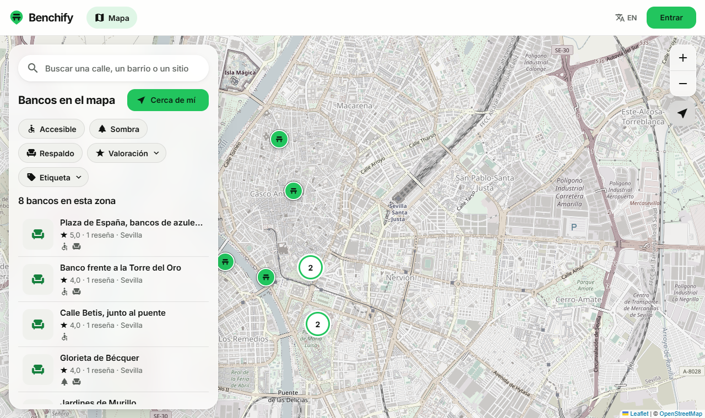
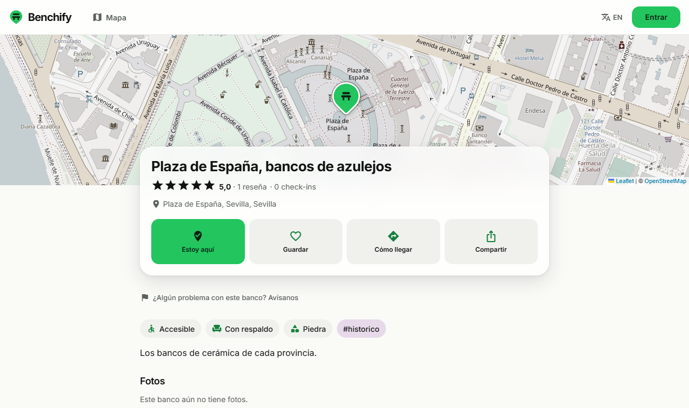
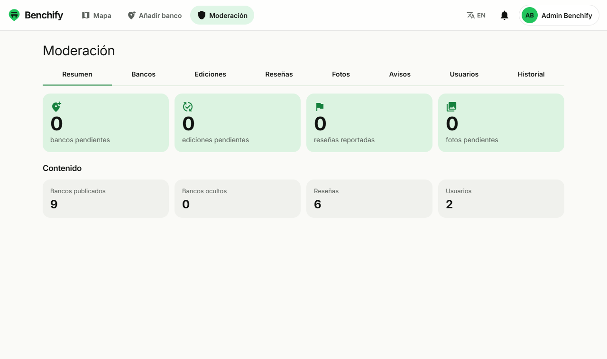
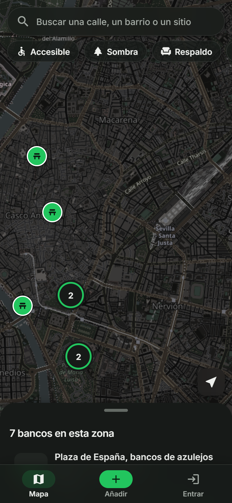
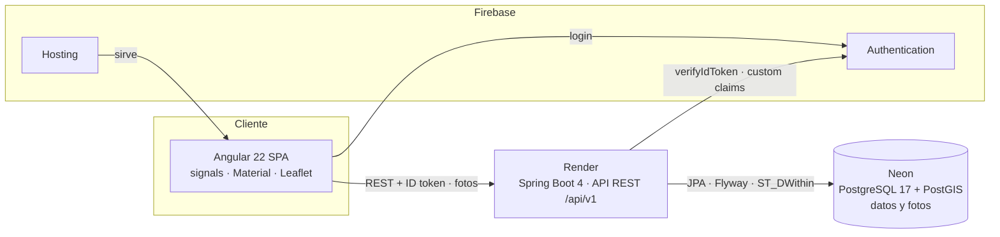
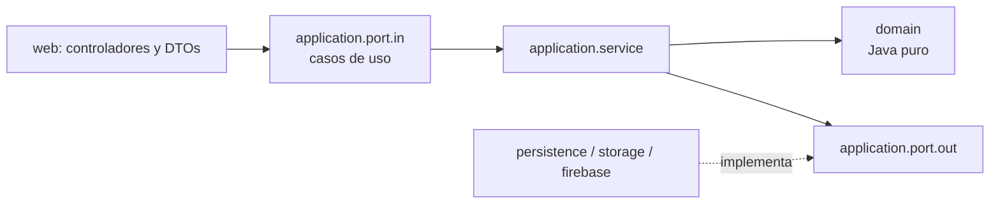

<div align="center">

# 🌳 Benchify

**Mapa colaborativo de bancos públicos.** Descubre bancos cerca de ti, valóralos, guárdalos en
favoritos, haz check-in cuando te sientes en uno, comparte fotos y avisa si alguno está roto. Cada
aportación pasa por moderación. En español e inglés, y se instala como aplicación.

[](https://github.com/Maanuu77/Benchify/actions/workflows/ci.yml)
[](https://github.com/Maanuu77/Benchify/releases/latest)


</div>

<p align="center">
  
</p>

| Ficha de banco | Moderación | Móvil (modo oscuro) |
|---|---|---|
|  |  |  |

## Funcionalidades

- **Mapa** a pantalla completa con clústeres, filtros en píldoras (accesible, sombra, respaldo,
  etiqueta, valoración), búsqueda **cerca de mí** con distancias reales calculadas por PostGIS y
  buscador de direcciones (OpenStreetMap). La vista y los filtros viajan en la URL.
- **Fichas** con reseñas (1–5 ★), fotos, favoritos, check-in validado por proximidad (≤ 150 m),
  enlace para llegar y **enlace para compartir** con vista previa en WhatsApp, Telegram o X.
- **Avisos** de bancos rotos, sucios o desaparecidos, con resumen público en la ficha.
- **Contribución**: alta de bancos con selector en el mapa y subida de fotos (se reducen en el
  navegador). Las ediciones de un banco publicado quedan pendientes sin retirarlo del mapa.
- **Moderación**: colas de bancos, ediciones, fotos (con posibles duplicados por huella perceptual),
  reseñas reportadas y avisos; motivo opcional, historial y gestión de roles.
- **Cuentas** con Firebase Authentication (email/contraseña y Google), verificación del email para
  publicar, notificaciones, perfiles públicos y baja de cuenta.
- **Diseño** minimalista con modo claro y oscuro automático, navegación inferior en móvil,
  **español e inglés** y **PWA** que funciona sin conexión con los últimos bancos vistos.

## Arquitectura



El backend sigue una **arquitectura hexagonal por feature** ([ADR-0004](docs/adr/0004-arquitectura-hexagonal-por-feature.md)),
verificada con ArchUnit en cada build:

```
backend/src/main/java/com/benchify/
├── shared/       Núcleo común: Actor, errores de dominio, paginación, seguridad Firebase, ProblemDetail
├── banco/        domain · application (port/in, port/out, service) · infrastructure (web, persistence, storage)
├── resena/       …mismo esquema por feature
├── usuario/
├── favorito/
├── checkin/
├── moderacion/
├── notificacion/
├── incidencia/   Avisos de bancos en mal estado
└── lugar/        Buscador de direcciones (Nominatim)
```



Decisiones documentadas en [`docs/adr`](docs/adr): monorepo, Spring Boot 4, hexagonal, PostGIS +
Flyway, Firebase Auth, estrategia de tests, frontend Angular y despliegue gratuito.

## Stack

| Capa | Tecnologías |
|------|-------------|
| Backend | Java 21, Spring Boot 4.1 (Web MVC, Security, Data JPA, Validation, Actuator), Hibernate 7, Flyway, MapStruct, springdoc-openapi 3, Firebase Admin SDK, Bucket4j, Caffeine, Thumbnailator |
| Datos | PostgreSQL 17 + PostGIS 3.5 (`geography`, índices GIST, `ST_DWithin`); las fotos, también en PostgreSQL en producción |
| Frontend | Angular 22 y TypeScript 6 (standalone, zoneless, signals), Angular Material, SDK de Firebase, Leaflet + markercluster, service worker de Angular |
| Tests | JUnit 5, Mockito, Testcontainers, ArchUnit, JaCoCo · Vitest, Playwright |
| DevOps | Docker, docker compose, GitHub Actions, Dependabot, Render, Neon, Firebase Hosting |

## Puesta en marcha local

**Requisitos:** Docker, JDK 21 y Node.js 22.

```bash
# 1. Variables (opcional: los valores por defecto ya funcionan en local)
cp .env.example .env

# 2. PostgreSQL + PostGIS y Firebase Emulator Suite
docker compose up -d

# 3. Backend (perfil dev: migraciones Flyway, datos de ejemplo de Sevilla y usuarios de prueba)
cd backend && ./mvnw spring-boot:run

# 4. Frontend
cd frontend && npm ci && npm start
```

| Servicio | URL |
|----------|-----|
| Aplicación | http://localhost:4200 |
| API y Swagger UI | http://localhost:8080/swagger-ui.html |
| Emulator UI (usuarios, ficheros) | http://localhost:4000 |
| PostgreSQL | `localhost:5433` (benchify / benchify) |

Usuarios de prueba creados al arrancar el backend: **admin@benchify.dev** (administrador) y
**ana@benchify.dev**, con la contraseña de `SEED_USERS_PASSWORD` (`.env.example`).

También puedes levantar el backend dentro de Docker: `docker compose --profile app up -d --build`.

> La imagen `postgis/postgis` solo se publica para amd64; en Apple Silicon Docker la ejecuta con emulación.

## Variables de entorno

Todas están descritas en [`.env.example`](.env.example). Las principales:

| Variable | Perfil | Descripción |
|----------|--------|-------------|
| `DB_URL`, `DB_USERNAME`, `DB_PASSWORD` | dev / prod | Conexión JDBC (en prod, Neon con `sslmode=require`) |
| `FIREBASE_PROJECT_ID` | dev / prod | Proyecto de Firebase |
| `ALMACEN_TIPO` | prod | Dónde se guardan las fotos: `postgres` (por defecto) o `firebase` (Cloud Storage, `FIREBASE_STORAGE_BUCKET`) |
| `API_PUBLIC_URL` | prod | Dirección pública de la API para las URLs de las fotos (en Render se toma sola) |
| `FIREBASE_AUTH_EMULATOR_HOST`, `FIREBASE_STORAGE_EMULATOR_URL` | dev | Emuladores locales |
| `WEB_URL` | prod | Dirección de la web, para los enlaces para compartir y el sitemap |
| `CORS_ALLOWED_ORIGINS` | prod | Orígenes del frontend, separados por comas |
| `API_DOCS_ENABLED` | prod | Publica Swagger UI (`false` por defecto) |
| `SEED_USERS_PASSWORD` | dev | Contraseña de los usuarios de prueba del emulador |
| `IT_DATABASE_URL` | test | PostGIS externo para los tests de integración si no hay Docker |

Las credenciales nunca se guardan en el repositorio: en producción la contraseña de la base de
datos es una variable del servicio de Render y la clave de Firebase Admin, un *Secret File*.

## Tests

```bash
cd backend && ./mvnw verify            # 455 tests: unitarios, slices web, PostGIS (Testcontainers), ArchUnit, JaCoCo
cd frontend && npm run test:ci         # 171 tests con Vitest y cobertura
cd frontend && npm run e2e             # Playwright (escritorio y móvil) con la API simulada
cd frontend && npm run e2e:stack       # Playwright contra backend + emuladores reales
```

| Suite | Cobertura mínima | Actual |
|-------|------------------|--------|
| Backend (CI, con PostGIS) | 85 % líneas · 70 % ramas | 96 % · 84 % |
| Backend (local sin PostGIS) | 70 % · 60 % | — |
| Frontend | 70 % líneas · 65 % ramas | 76 % · 72 % |

Sin Docker, los tests de integración pueden usar un PostGIS propio con `IT_DATABASE_URL`.

GitHub Actions ejecuta un job por aplicación, filtrado por la carpeta que cambia: build, tests y
cobertura del backend más la imagen Docker (analizada con Trivy); lint, tests, build y e2e del
frontend. Además pasan CodeQL y la revisión de dependencias, y Dependabot propone las
actualizaciones cada semana.

## API

Documentación OpenAPI en `/v3/api-docs` y Swagger UI en `/swagger-ui.html`. Todos los errores
siguen [RFC 9457](https://www.rfc-editor.org/rfc/rfc9457) con un `code` estable:

```json
{ "status": 409, "title": "Conflict", "detail": "Ya has reseñado este banco; edita tu reseña",
  "instance": "/api/v1/bancos/…/resenas", "code": "RESENA_DUPLICADA" }
```

## Despliegue

Todo en planes gratuitos sin tarjeta: frontend en **Firebase Hosting**, backend en **Render** y
base de datos (con las fotos) en **Neon**. Render despliega el backend con cada cambio en `main` y
GitHub Actions publica el frontend en Hosting sin claves (Workload Identity Federation), con canal
de vista previa en cada PR. Guía paso a paso en [`deploy/README.md`](deploy/README.md)
([ADR-0010](docs/adr/0010-neon-y-despliegue-continuo.md)).

## Forma de trabajo

- **Git Flow**: `main` (estable) ← `release/*` ← `develop` ← `feature/*`, `fix/*`, `chore/*`,
  `ci/*`, `docs/*`, integradas con `git merge --no-ff` y un mensaje tipo PR.
- Una rama y un PR a `develop` por bloque de trabajo; se fusiona con la CI en verde.
- **Conventional Commits** en inglés, cada uno referenciando su issue de GitHub
  ([tablero](https://github.com/users/Maanuu77/projects/1), [roadmap](docs/ROADMAP.md)).
- Cambios en [`CHANGELOG.md`](CHANGELOG.md) y versiones en [Releases](https://github.com/Maanuu77/Benchify/releases).

## Estructura del repositorio

| Carpeta | Contenido |
|---------|-----------|
| [`backend/`](backend) | API REST Spring Boot (Maven) |
| [`frontend/`](frontend) | SPA Angular ([README](frontend/README.md)) |
| [`deploy/`](deploy) | Scripts y guía de despliegue (Render, Neon, Firebase) |
| [`docker/`](docker) | Imagen de Firebase Emulator Suite |
| [`docs/`](docs) | Roadmap, ADRs, documento de producto y capturas |
