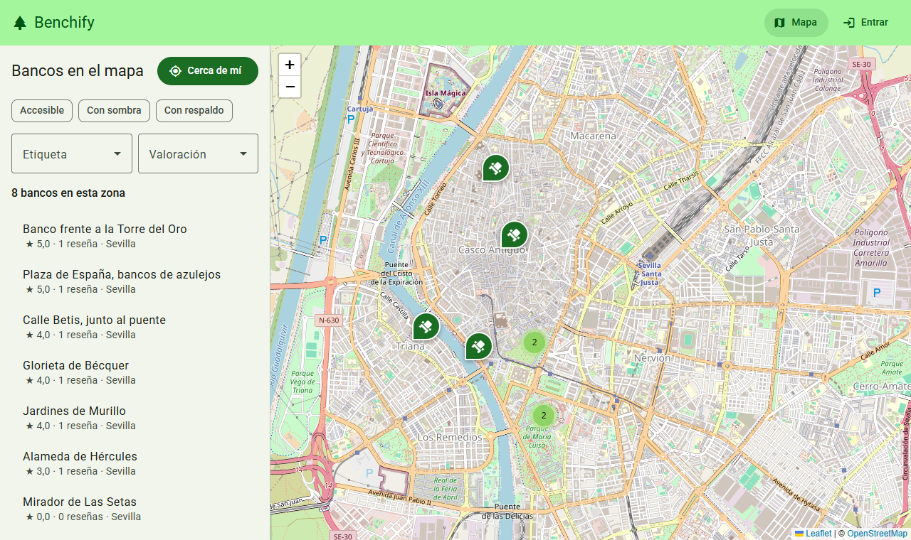
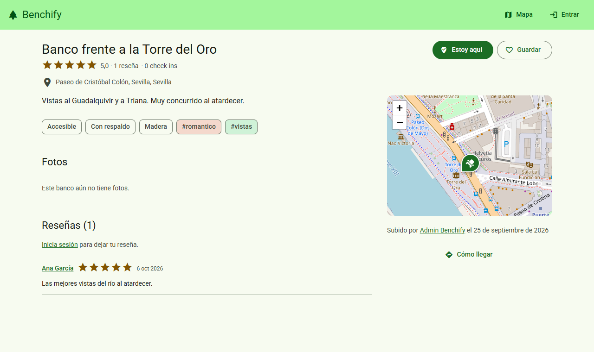
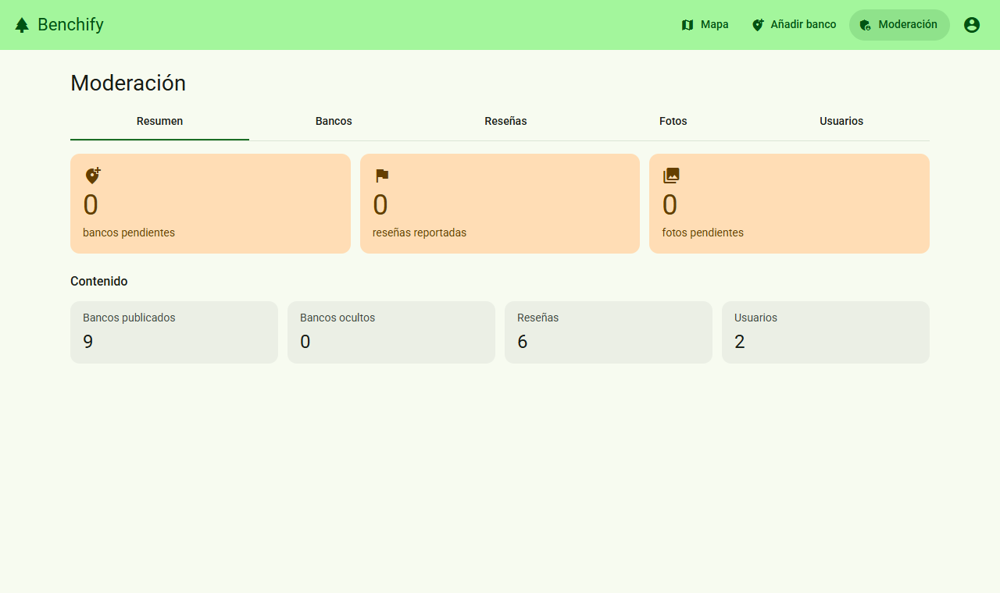
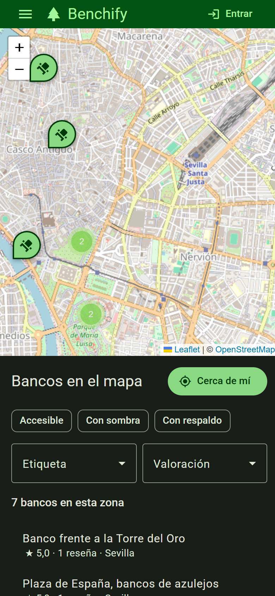
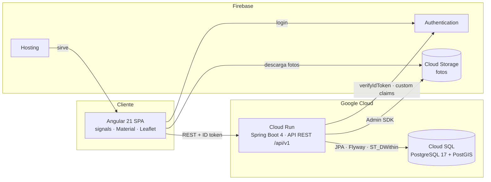
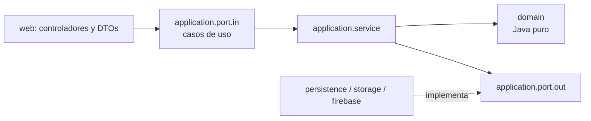

<div align="center">

# 🌳 Benchify

**Mapa colaborativo de bancos públicos.** Descubre bancos cerca de ti, valóralos, guárdalos en
favoritos, haz check-in cuando te sientes en uno y comparte fotos. Cada aportación pasa por moderación.

[](https://github.com/Maanuu77/Benchify/actions/workflows/ci.yml)


</div>

<p align="center">
  
</p>

| Ficha de banco | Moderación | Móvil (modo oscuro) |
|---|---|---|
|  |  |  |

## Funcionalidades

- **Mapa** con clustering, filtros (accesible, sombra, respaldo, etiqueta, valoración) y búsqueda
  **cerca de mí** con distancias reales calculadas por PostGIS.
- **Fichas** con reseñas (1–5 ★), fotos, favoritos, check-in validado por proximidad (≤ 150 m)
  y enlace para llegar.
- **Contribución**: alta y edición de bancos con selector en el mapa y subida de fotos.
- **Moderación**: cola de bancos, reseñas reportadas (3 reportes de usuarios distintos), fotos
  pendientes y gestión de roles.
- **Cuentas** con Firebase Authentication (email/contraseña y Google) y perfiles públicos.

## Arquitectura



El backend sigue una **arquitectura hexagonal por feature** ([ADR-0004](docs/adr/0004-arquitectura-hexagonal-por-feature.md)),
verificada con ArchUnit en cada build:

```
backend/src/main/java/com/benchify/
├── shared/       Núcleo común: Actor, errores de dominio, paginación, seguridad Firebase, ProblemDetail
├── banco/        domain · application (port/in, port/out, service) · infrastructure (web, persistence, storage)
├── resena/       …mismo esquema por feature
├── usuario/
├── favorito/
├── checkin/
└── moderacion/
```



Decisiones documentadas en [`docs/adr`](docs/adr): monorepo, Spring Boot 4, hexagonal, PostGIS +
Flyway, Firebase Auth, estrategia de tests, Angular 21 y despliegue.

## Stack

| Capa | Tecnologías |
|------|-------------|
| Backend | Java 21, Spring Boot 4.1 (Web MVC, Security, Data JPA, Validation, Actuator), Hibernate 7, Flyway, MapStruct, springdoc-openapi 3, Firebase Admin SDK |
| Datos | PostgreSQL 17 + PostGIS 3.5 (`geography`, índices GIST, `ST_DWithin`) |
| Frontend | Angular 21 (standalone, zoneless, signals, control flow), Angular Material 3, AngularFire 21, Leaflet + markercluster |
| Tests | JUnit 5, Mockito, Testcontainers, ArchUnit, JaCoCo · Vitest, Playwright |
| DevOps | Docker, docker compose, GitHub Actions, Dependabot, Cloud Run, Cloud SQL, Firebase Hosting |

## Puesta en marcha local

**Requisitos:** Docker, JDK 21 y Node.js 22.

```bash
# 1. Variables (opcional: los valores por defecto ya funcionan en local)
cp .env.example .env

# 2. PostgreSQL + PostGIS y Firebase Emulator Suite
docker compose up -d

# 3. Backend (perfil dev: migraciones Flyway, datos de ejemplo de Sevilla y usuarios de prueba)
cd backend && ./mvnw spring-boot:run

# 4. Frontend
cd frontend && npm ci && npm start
```

| Servicio | URL |
|----------|-----|
| Aplicación | http://localhost:4200 |
| API y Swagger UI | http://localhost:8080/swagger-ui.html |
| Emulator UI (usuarios, ficheros) | http://localhost:4000 |
| PostgreSQL | `localhost:5433` (benchify / benchify) |

Usuarios de prueba creados al arrancar el backend: **admin@benchify.dev** (administrador) y
**ana@benchify.dev**, con la contraseña de `SEED_USERS_PASSWORD` (`.env.example`).

También puedes levantar el backend dentro de Docker: `docker compose --profile app up -d --build`.

> La imagen `postgis/postgis` solo se publica para amd64; en Apple Silicon Docker la ejecuta con emulación.

## Variables de entorno

Todas están descritas en [`.env.example`](.env.example). Las principales:

| Variable | Perfil | Descripción |
|----------|--------|-------------|
| `DB_URL`, `DB_USERNAME`, `DB_PASSWORD` | dev / prod | Conexión JDBC (en prod, con el conector de Cloud SQL) |
| `FIREBASE_PROJECT_ID`, `FIREBASE_STORAGE_BUCKET` | dev / prod | Proyecto de Firebase y bucket de fotos |
| `FIREBASE_AUTH_EMULATOR_HOST`, `FIREBASE_STORAGE_EMULATOR_URL` | dev | Emuladores locales |
| `CORS_ALLOWED_ORIGINS` | prod | Orígenes del frontend, separados por comas |
| `API_DOCS_ENABLED` | prod | Publica Swagger UI (`false` por defecto) |
| `SEED_USERS_PASSWORD` | dev | Contraseña de los usuarios de prueba del emulador |
| `IT_DATABASE_URL` | test | PostGIS externo para los tests de integración si no hay Docker |

Las credenciales nunca se guardan en el repositorio: en producción el backend usa la cuenta de
servicio de Cloud Run y la contraseña de la base de datos llega desde Secret Manager.

## Tests

```bash
cd backend && ./mvnw verify            # 247 tests: unitarios, slices web, PostGIS (Testcontainers), ArchUnit, JaCoCo
cd frontend && npm run test:ci         # Vitest con cobertura
cd frontend && npm run e2e             # Playwright (escritorio y móvil) con la API simulada
cd frontend && npm run e2e:stack       # Playwright contra backend + emuladores reales
```

| Suite | Cobertura mínima | Actual |
|-------|------------------|--------|
| Backend (CI, con Testcontainers) | 85 % líneas · 70 % ramas | 95 % · 82 % |
| Backend (local sin Docker) | 70 % · 60 % | 73 % · 73 % |
| Frontend | 70 % líneas · 65 % ramas | 73 % · 73 % |

GitHub Actions ejecuta un job por aplicación, filtrado por la carpeta que cambia: build, tests y
cobertura del backend más la imagen Docker; lint, tests, build y e2e del frontend.

## API

Documentación OpenAPI en `/v3/api-docs` y Swagger UI en `/swagger-ui.html`. Todos los errores
siguen [RFC 9457](https://www.rfc-editor.org/rfc/rfc9457) con un `code` estable:

```json
{ "status": 409, "title": "Conflict", "detail": "Ya has reseñado este banco; edita tu reseña",
  "instance": "/api/v1/bancos/…/resenas", "code": "RESENA_DUPLICADA" }
```

## Despliegue

Backend en **Cloud Run** con Cloud SQL y frontend en **Firebase Hosting**: guía paso a paso en
[`deploy/README.md`](deploy/README.md) ([ADR-0009](docs/adr/0009-despliegue-cloud-run-firebase-hosting.md)).

## Forma de trabajo

- **Git Flow**: `main` (estable) ← `release/*` ← `develop` ← `feature/*`, `fix/*`, `chore/*`,
  `ci/*`, `docs/*`, integradas con `git merge --no-ff` y un mensaje tipo PR.
- **Conventional Commits** en inglés, cada uno referenciando su issue del [roadmap](docs/ROADMAP.md).
- Cambios en [`CHANGELOG.md`](CHANGELOG.md).

## Estructura del repositorio

| Carpeta | Contenido |
|---------|-----------|
| [`backend/`](backend) | API REST Spring Boot (Maven) |
| [`frontend/`](frontend) | SPA Angular ([README](frontend/README.md)) |
| [`deploy/`](deploy) | Cloud Run y guía de despliegue |
| [`docker/`](docker) | Imagen de Firebase Emulator Suite |
| [`docs/`](docs) | Roadmap, ADRs, documento de producto y capturas |
