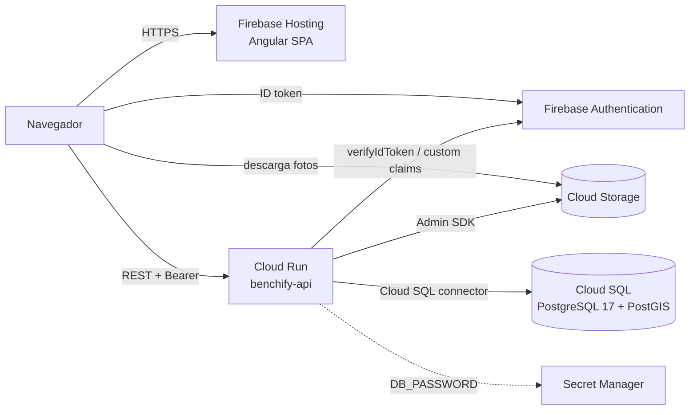

# Despliegue en Google Cloud y Firebase



## 1. Preparación (una vez por proyecto)

Sustituye `benchify-prod` por el ID de tu proyecto de Firebase (también en `.firebaserc`).

```bash
export PROJECT_ID=benchify-prod REGION=europe-southwest1
gcloud config set project $PROJECT_ID

gcloud services enable run.googleapis.com sqladmin.googleapis.com artifactregistry.googleapis.com \
  cloudbuild.googleapis.com secretmanager.googleapis.com

# Registro de imágenes
gcloud artifacts repositories create benchify --repository-format=docker --location=$REGION

# Base de datos (PostGIS viene incluido en Cloud SQL para PostgreSQL)
gcloud sql instances create benchify --database-version=POSTGRES_17 --region=$REGION \
  --tier=db-custom-1-3840 --storage-auto-increase
gcloud sql databases create benchify --instance=benchify
openssl rand -base64 24 | tr -d '\n' > db-password.txt
gcloud sql users create benchify --instance=benchify --password="$(cat db-password.txt)"
gcloud secrets create benchify-db-password --data-file=db-password.txt && rm db-password.txt

# PostGIS debe crearlo un usuario con rol cloudsqlsuperuser (el usuario "postgres"):
#   gcloud sql connect benchify --user=postgres --database=benchify
#   CREATE EXTENSION IF NOT EXISTS postgis;  GRANT ALL ON SCHEMA public TO benchify;

# Cuenta de servicio del backend con los permisos mínimos
gcloud iam service-accounts create benchify-api
SA=benchify-api@$PROJECT_ID.iam.gserviceaccount.com
for role in roles/cloudsql.client roles/secretmanager.secretAccessor roles/firebaseauth.admin; do
  gcloud projects add-iam-policy-binding $PROJECT_ID --member=serviceAccount:$SA --role=$role
done
gsutil iam ch serviceAccount:$SA:roles/storage.objectAdmin gs://$PROJECT_ID.appspot.com
```

En la consola de Firebase: activa **Authentication** (proveedores *Email/contraseña* y *Google*,
y añade el dominio de Hosting a los dominios autorizados) y **Storage**.

## 2. Backend en Cloud Run

```bash
PROJECT_ID=benchify-prod \
CLOUD_SQL_INSTANCE=benchify-prod:europe-southwest1:benchify \
CORS_ALLOWED_ORIGINS=https://benchify-prod.web.app,https://benchify-prod.firebaseapp.com \
./deploy/cloudrun/deploy.sh
```

El script construye la imagen con Cloud Build, la sube a Artifact Registry y aplica
[`cloudrun/service.yaml`](cloudrun/service.yaml): perfil `prod`, conexión a Cloud SQL con el
conector oficial (TLS autorizado por IAM), contraseña desde Secret Manager y probes de
arranque y vida sobre `/actuator/health`. Flyway aplica las migraciones al arrancar.

Ninguna credencial entra en la imagen: el Admin SDK de Firebase usa la cuenta de servicio de
Cloud Run (Application Default Credentials).

## 3. Frontend en Firebase Hosting

1. En `frontend/src/environments/environment.prod.ts` pon la configuración web de Firebase
   (Consola → Configuración del proyecto → Tus apps) y la URL de Cloud Run que imprimió el paso 2.
2. Despliega Hosting y las reglas de Storage:

```bash
npx firebase-tools deploy --only hosting,storage --project benchify-prod
```

`firebase.json` compila el frontend antes de subirlo (`predeploy`), reescribe todas las rutas a
`index.html` (SPA), sirve los ficheros con hash con caché inmutable de un año, `index.html` sin
caché y añade cabeceras de seguridad.

## 4. Primer administrador

Los roles son custom claims de Firebase. Para el primer ADMIN (después, desde el panel):

```bash
# Con credenciales de administrador del proyecto (gcloud auth application-default login)
node -e "
const admin=require('firebase-admin'); admin.initializeApp({projectId:'benchify-prod'});
admin.auth().getUserByEmail(process.argv[1]).then(u=>admin.auth().setCustomUserClaims(u.uid,{role:'ADMIN'}))
  .then(()=>console.log('ok'));" tu-email@ejemplo.com
```
