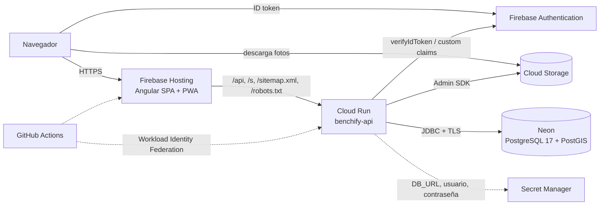

# Despliegue en Google Cloud, Firebase y Neon



- **Hosting** sirve la aplicación y reenvía la API a Cloud Run: aplicación y API comparten dominio
  (`https://<proyecto>.web.app`), sin CORS ni URL de Cloud Run en el build.
- **Cloud Run** (`europe-west1`, Bélgica) escala a cero. El arranque en frío se acorta con Class Data
  Sharing: la imagen trae preparadas las clases que carga Spring (de ~7 s a ~4,5 s en local).
- **Neon** (`AWS eu-central-1`, Fráncfort, a pocos milisegundos de Cloud Run) también se suspende
  sin uso; la primera consulta tras un rato tarda un poco más.

## 1. Preparación (una vez)

1. **Firebase**: crea el proyecto en la [consola](https://console.firebase.google.com) y dentro:
   - una **app web** (de ahí salen `apiKey` y `appId`);
   - **Authentication** con los proveedores *Email/contraseña* y *Google*;
   - **Storage**.
2. **Neon**: crea un proyecto en [neon.tech](https://neon.tech) en *AWS eu-central-1* con PostgreSQL
   17. Necesitarás el host del endpoint **directo** (sin `-pooler`: Flyway usa bloqueos de sesión que
   el pooler no admite), la base de datos, el usuario y la contraseña. PostGIS lo crea la primera
   migración.
3. **Google Cloud**: con `gcloud auth login` hecho, ejecuta

   ```bash
   PROJECT_ID=mi-proyecto ./deploy/preparar-proyecto.sh
   ```

   Activa las APIs y crea:
   - el registro de imágenes;
   - la cuenta de servicio del backend, con permisos mínimos;
   - los secretos de Neon (los pide sin dejarlos en el historial);
   - la cuenta del despliegue continuo con Workload Identity Federation, limitada a este repositorio.

   Al terminar muestra las variables que hay que definir en GitHub.
4. **GitHub**: define esas variables (*Settings → Secrets and variables → Actions → Variables*). No
   hay secretos: la identidad de GitHub Actions se verifica con OIDC.

## 2. Despliegue continuo

[`.github/workflows/deploy.yml`](../.github/workflows/deploy.yml):

- **Al llegar a `main`**:
  1. construye la imagen del backend, la sube a Artifact Registry y la despliega en Cloud Run;
  2. comprueba `/actuator/health`;
  3. publica el frontend en Hosting.
- **En los PRs que tocan el frontend**: publica un **canal de vista previa** (`pr-<número>`, caduca a
  los 7 días) contra la API de producción. El enlace queda en el resumen del job.

Mientras las variables no estén definidas, el workflow no hace nada.

## 3. Despliegue a mano (opcional)

```bash
# Backend: Cloud Build + Cloud Run
PROJECT_ID=mi-proyecto ./deploy/cloudrun/deploy.sh

# Frontend: escribe la configuración de Firebase y publica Hosting (firebase.json compila antes)
FIREBASE_PROJECT_ID=mi-proyecto FIREBASE_API_KEY=... FIREBASE_APP_ID=... node deploy/configurar-frontend.mjs
npx firebase-tools deploy --only hosting,storage --project mi-proyecto
```

`firebase.json` reescribe las rutas de la SPA a `index.html` y cachea un año solo los ficheros con
hash; `index.html`, el service worker y el manifest van sin caché. También añade las cabeceras de
seguridad (CSP incluida).

Ninguna credencial entra en la imagen: el Admin SDK de Firebase usa la cuenta de servicio de Cloud
Run (Application Default Credentials) y la base de datos llega desde Secret Manager.

## 4. Primer administrador

Los roles son custom claims de Firebase. Para el primer ADMIN (después, desde el panel):

```bash
# Con credenciales de administrador del proyecto (gcloud auth application-default login)
node -e "
const admin=require('firebase-admin'); admin.initializeApp({projectId:'mi-proyecto'});
admin.auth().getUserByEmail(process.argv[1]).then(u=>admin.auth().setCustomUserClaims(u.uid,{role:'ADMIN'}))
  .then(()=>console.log('ok'));" tu-email@ejemplo.com
```
