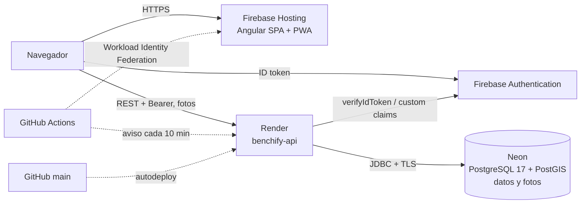

# Despliegue gratuito: Firebase, Render y Neon

Todo cabe en planes gratuitos que no piden tarjeta.



| Pieza | Servicio (plan gratuito) | Qué conviene saber |
|---|---|---|
| Web y PWA | Firebase Hosting (Spark) | `https://benchify-86edd.web.app` |
| Inicio de sesión | Firebase Authentication (Spark) | Email/contraseña y Google, hasta 50 000 usuarios al mes |
| API | Render, servicio web gratuito (Fráncfort) | 512 MB. Duerme tras 15 min sin peticiones; un aviso cada 10 min desde GitHub Actions lo mantiene despierto (cabe en las 750 h gratuitas al mes) |
| Datos y fotos | Neon, PostgreSQL 17 + PostGIS (AWS eu-central-1) | 0,5 GB en total. Se suspende sin uso y se despierta solo con la siguiente consulta |

Firebase Storage necesita el plan de pago, así que las fotos se guardan en la base de datos
(`benchify.almacen.tipo=postgres`). Con fotos de 1600 px caben unas mil. Las aprobadas se sirven
desde la API con caché de un año; las pendientes, solo a quien puede verlas.

La API vive en el dominio de Render. Los enlaces para compartir con vista previa (`/s/{id}`) y el
`sitemap.xml` también, y el `robots.txt` de la web apunta a ese sitemap.

## 1. Preparación (una vez)

1. **Firebase** (consola, proyecto `benchify-86edd`):
   - **Authentication**: proveedores *Email/contraseña* y *Google*.
   - **Clave de la cuenta de servicio**: *Configuración del proyecto → Cuentas de servicio →
     Generar nueva clave privada*. El backend la usa para verificar tokens y asignar roles. No la
     subas al repositorio.
2. **Neon** ([neon.tech](https://neon.tech)): proyecto en *AWS eu-central-1* con PostgreSQL 17.
   - Apunta el host del endpoint **directo** (sin `-pooler`: Flyway usa bloqueos de sesión), la base
     de datos, el usuario y la contraseña.
   - PostGIS lo crea la primera migración.
3. **Render** ([render.com](https://render.com), con la cuenta de GitHub): *New → Blueprint* sobre este
   repositorio. Lee [`render.yaml`](../render.yaml) y pide:
   - `DB_URL`: `jdbc:postgresql://<host>/<base de datos>?sslmode=require`;
   - `DB_USERNAME` y `DB_PASSWORD`.

   Después, en el servicio, *Environment → Secret Files*: añade `firebase-admin.json` con el contenido
   de la clave del paso 1. Render despliega el backend cada vez que un cambio del backend llega a `main`.
4. **GitHub Actions** (despliegue del frontend sin claves): en Cloud Shell, con el proyecto de Firebase,
   ejecuta `PROJECT_ID=benchify-86edd ./deploy/preparar-proyecto.sh`. No necesita facturación. Después
   define las variables del repositorio (*Settings → Secrets and variables → Actions → Variables*):

   | Variable | Valor |
   |---|---|
   | `API_URL` | URL del servicio de Render, p. ej. `https://benchify-api.onrender.com` |
   | `FIREBASE_PROJECT_ID` | `benchify-86edd` |
   | `FIREBASE_API_KEY`, `FIREBASE_APP_ID` | Los de la app web (`firebase apps:sdkconfig`) |
   | `GCP_WIF_PROVIDER`, `GCP_DEPLOY_SA` | Los que muestra `preparar-proyecto.sh` |

## 2. Despliegue continuo

- **Backend**: Render, al llegar a `main` un cambio en `backend/`.
- **Frontend**: [`.github/workflows/deploy.yml`](../.github/workflows/deploy.yml).
  - Al llegar a `main`, escribe la configuración (`configurar-frontend.mjs`) y publica Hosting.
  - En los PRs del frontend publica un canal de vista previa (`pr-<número>`, caduca a los 7 días).
  - Sin las variables, no hace nada.
- **Backend despierto**: [`despertar-backend.yml`](../.github/workflows/despertar-backend.yml) avisa a
  la API cada 10 minutos.

## 3. Frontend a mano (opcional)

```bash
API_URL=https://benchify-api.onrender.com FIREBASE_PROJECT_ID=benchify-86edd \
FIREBASE_API_KEY=... FIREBASE_APP_ID=... node deploy/configurar-frontend.mjs
npx firebase-tools deploy --only hosting --project benchify-86edd
```

`firebase.json` compila antes de subir y reescribe las rutas de la SPA a `index.html`. Solo los
ficheros con hash se cachean un año; `index.html`, el service worker y el manifest van sin caché. También
añade las cabeceras de seguridad (CSP incluida, con la API de Render permitida).

## 4. Primer administrador

Los roles son custom claims de Firebase. Para el primer ADMIN (después, desde el panel), con la clave
de la cuenta de servicio del paso 1:

```bash
GOOGLE_APPLICATION_CREDENTIALS=firebase-admin.json node -e "
const admin=require('firebase-admin'); admin.initializeApp({projectId:'benchify-86edd'});
admin.auth().getUserByEmail(process.argv[1]).then(u=>admin.auth().setCustomUserClaims(u.uid,{role:'ADMIN'}))
  .then(()=>console.log('ok'));" tu-email@ejemplo.com
```

## Si algún día se pasa a un plan de pago

Con el plan Blaze de Firebase se puede volver a Cloud Run y Cloud Storage (fotos fuera de la base de
datos y API en el mismo dominio): `benchify.almacen.tipo=firebase` y una reescritura `/api/**` en
`firebase.json`. El historial de esta carpeta y el ADR-0010 explican cómo estaba montado.
